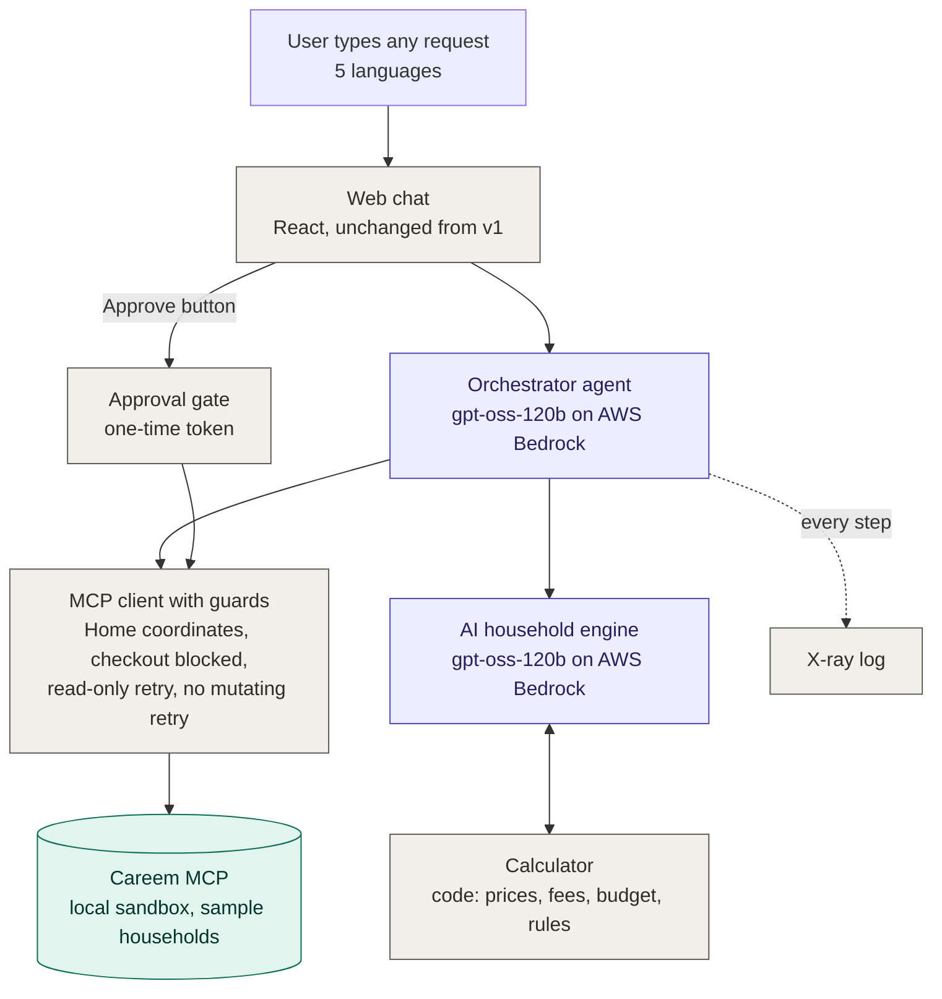
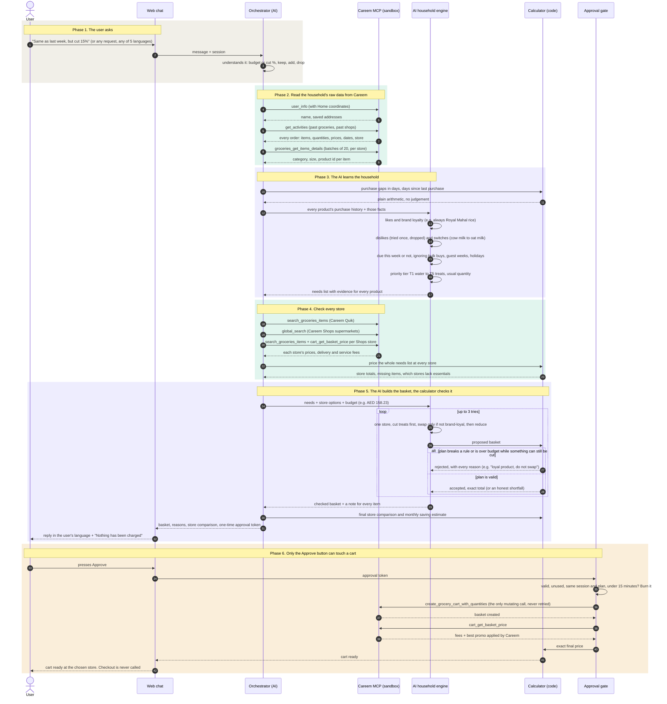
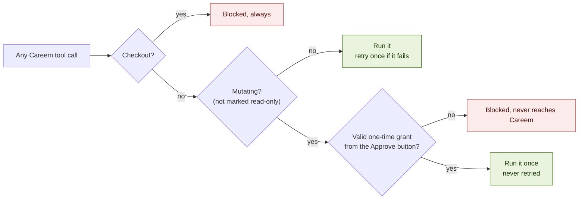

# Souq Saver v2: flowchart in chronological order

How one request moves through SAP V2, from the moment the user types to the moment the cart is
ready. GitHub draws the diagrams below automatically (Mermaid). The numbers in the example come from
the sample household Leonardo DiCappuccino; they change with the household and the request.

## 1. The parts

## 2. One request, step by step

## 3. Safety rules on the way (Careem's "Ship it safely")

## What is AI and what is code

| Step | Done by |
|---|---|
| Understanding the request | AI (orchestrator) |
| Learning the household: likes, dislikes, switches, what is due, tiers | AI (household engine) |
| Choosing the store, cuts, swaps and quantities | AI (household engine) |
| Purchase gaps, every price, fee, total, budget and saving | Calculator (code) |
| Rejecting a plan that breaks the household's rules | Calculator (code) |
| Approving and building the cart | The user, through the Approve button |
