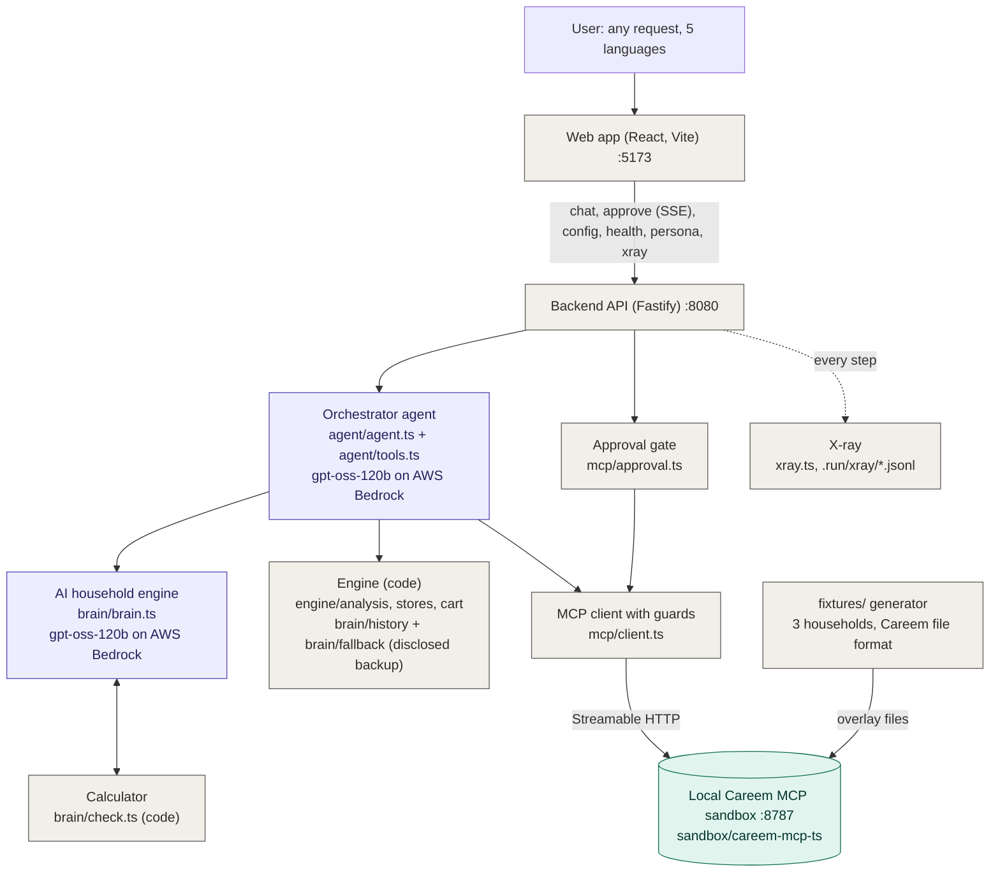

# Souq Saver v2: full context, A to Z

Everything about SAP V2 in one file: what it is, how it is built, every frontend and backend
component, how data flows, how the AI is used, how it stays safe, how to run and demo it, and what
is not built. For the step-by-step diagrams see [FLOWCHART.md](FLOWCHART.md); for the short change
list from v1 see [SAP_V2.md](SAP_V2.md).

---

## 1. What Souq Saver is

A budget-aware household grocery agent on the **Careem MCP**, built at **Careem Builders '26: Hack To
The Future (powered by AWS)**, 14 Nov 2026, Careem HQ, Dubai. Team: Sameer Pahwa and Prakhar Shukla.

You type a request in your own words, for example *"Same as last week, but cut 15%"* or *"I only have
120 dirhams, keep my chips, add 2 kg of bananas"*, in English, Arabic, Hindi, Urdu or Tagalog.
Souq Saver reads the household's Careem order history, an **AI household engine** learns what this
household likes, dislikes, has switched away from and needs this week, and builds the basket at the
**cheapest suitable store** (Careem Quik or a Careem Shops supermarket), filling it by priority (water
and staples first, treats last). A **calculator** written in code checks every number. Nothing is
charged: the user approves, a cart is built, and checkout is never called.

**The pitch in one line:** Careem gives us the data; our AI engine turns it into understanding; our
code makes sure every number is right.

## 2. v1 and v2

| | SAP V1 (`sap v1/`) | SAP V2 (`sap v2/`, this folder) |
|---|---|---|
| Decisions | Fixed rules (category regex, 75% order share, median gaps) | AI household engine on AWS Bedrock |
| Numbers | Code | Code (the calculator), unchanged principle |
| Agent | Rule-based stub (Bedrock was not connected) | OpenAI gpt-oss-120b on AWS Bedrock |
| Data | 10 weekly orders, one household | Leonardo enriched to 16 weeks + 2 new households |
| Frontend | Chat, steps, stores, basket, insights, X-ray | Same, plus **household profile panel** and **household buttons** |
| Typed requests | Demo phrases | Any request; honest shortfall when a budget is impossible |
| Safety net | Approval token, checkout blocked | Plus: limits, need/product compatibility checks, runtime tool validation, grounded replies, a disclosed rule-based fallback that keeps the household profile |

## 3. Quick start

```bash
cd "sap v2"
npm install
cp .env.example .env      # add AWS keys; model ids are pre-filled
npm run dev               # sandbox :8787 + backend :8080 + web :5173 -> open http://localhost:5173
```

Other commands:

| Command | What it does |
|---|---|
| `npm run dev:backend` | Sandbox + backend only |
| `npm run demo:cli` | The whole demo in the terminal, no UI (`-- --xray` prints every step) |
| `npm run xray -- <runId>` | Pretty-print a saved X-ray run |
| `npm test` | Regenerates Leonardo's data, then all tests |
| `npx vitest run --config stress/vitest.config.ts` | The stress suites (hostile model output, hostile HTTP, round 2 attacks on the safety net) |
| `node --env-file=.env stress/live-ai.ts` | Live stress against Bedrock: hostile prompts in parallel, the pitch request in English and Arabic |
| `npm run persona -- leonardo\|family\|single` | Switch the demo household from a terminal |
| `npm run generate:data` | Regenerate the current default household (Leonardo) |
| `node server/scripts/eval-models.ts <modelId>` | Score a Bedrock model on a household (`PERSONA=family` etc.) |
| `npm run sandbox -- scenarios get_activities` | Inspect the sandbox's scenarios |

Needs Node 23.6 or newer. Everything runs on localhost.

## 4. Architecture



Three processes, started together by `scripts/dev.mjs`:

| Process | Port | Folder |
|---|---|---|
| Careem MCP sandbox | 8787 (`/mcp`, `/health`) | `sandbox/careem-mcp-ts` |
| Backend | 8080 (`/api/*`) | `server` |
| Web app | 5173 | `web` |

## 5. One request, in time order

1. **User** types a request (or clicks an example) and presses send.
2. **Web** posts `/api/chat` and listens to Server-Sent Events. The API checks the request first (message length, budget range) and answers a structured 400 error if it is invalid.
3. **Request check (code):** explicit values in the user's own words are checked before any planning: "cut 150%", "budget -50 AED", "500 bags of rice" are refused with a clear message and the previous budget is kept.
4. **Orchestrator** (gpt-oss-120b) reads the system prompt (Careem's playbook + Souq Saver rules) and calls the planning tool `plan_basket` with the budget, cut %, items to keep, add or drop. Every tool call is validated against a runtime schema before it runs; a bad call goes back to the model as a structured error so it can fix it (up to 3 corrections). A budget the user never gave is refused.
5. **Careem MCP, raw history:** `user_info` → `get_activities` (past groceries, past shops, up to 3 pages of 35) → `groceries_get_items_details` in batches of 20 per store.
6. **Engine (code):** normalise orders, category spend, price drift, last week's total.
7. **Careem MCP, stores:** `search_groceries_items` (Quik) → `global_search` (Shops supermarkets) → `search_groceries_items` per Shops store → `cart_get_basket_price` per store (fees).
8. **AI engine, learn:** one record per product across stores with purchases (date, weekday, qty, price, store) plus calculator facts (purchase gaps in days, days since last). It returns, per product, due / not_due / stopped / occasional, tier, usual qty, loyalty, evidence; plus likes, dislikes, switches and a household profile. **The answer is validated against the history rules** (`brain/history.ts`): duplicates, unknown products, invalid tiers and quantities the history does not support are corrected; a product clearly replaced by another (cow milk → oat milk) stays stopped; an alternative tried and dropped makes the household loyal.
9. **Calculator:** prices the whole needs list at every store (missing items, essentials). For each need it lists only products that really satisfy it (same product, or same category and a compatible pack size).
10. **AI engine, build:** picks one store, keeps/swaps/reduces/cuts each need within the outcomes allowed for it, writes a note per item.
11. **Calculator, check:** prices, fees, budget, loyalty, essentials, need/product compatibility, discontinued products, honest labels, limits, every need once. If rejected, the reasons go back to the AI, which revises (up to 3 tries). An over-budget plan is accepted only when nothing allowed is left to cut, and the shortfall is shown.
12. **Fallback (only if the AI's basket still fails):** the rule-based planner (`brain/fallback.ts`) builds a basket from the **same needs and household profile**, and it goes through the same calculator. The plan, the chat reply and the basket card say so. Without Bedrock, the household is read by the history rules instead.
13. **Backend** builds the plan: basket lines, cuts, unavailable items, deferred (with next due date), stopped items, store comparison (calculator), monthly saving estimate, household profile, `engine` (who built it) and `approval` (whether it can be approved). A one-time approval token is issued **only if the plan is valid and within budget**, bound to a fingerprint of the exact plan.
14. **Reply:** facts (budget, store, totals, fees, savings, item changes, approval status) are rendered from the validated plan with fixed sentences in the user's language; model prose that cites amounts the plan does not contain is replaced. The conversation stored for the next turn is always valid for Bedrock.
15. **Web** shows the reply, the household profile, store comparison, basket, insights, and the Approve button (turned off with the reason when the plan is over budget).
16. **Approve:** `/api/approve` with the token → token checked, burned and matched to the plan fingerprint → plan re-checked → `create_grocery_cart_with_quantities` (the only mutating call, never retried) → `cart_get_basket_price` → calculator prices the cart → "cart ready, nothing charged". Checkout is never called.

If the model loops past 8 turns, a request passes 240 s, or the browser disconnects, the turn stops cleanly: the user gets a clear message (when still connected), nothing half-done is saved, the session is released, and the next message works without Reset.

## 6. Backend components (`server/`)

### Entry and API

| File | Role |
|---|---|
| `src/index.ts` | Starts the backend. Loads `.env`, builds the Careem MCP client, picks the model: Bedrock if a hello-world call works, otherwise the marked stub, retrying Bedrock every 30 s |
| `src/api/server.ts` | Fastify HTTP API, CORS for the web origin, request validation with structured errors (`{ error, code, kind, field }`), one request at a time per session, client-disconnect abort, every request is an X-ray run streamed as SSE |
| `src/api/sseClient.ts` | Minimal SSE client used by the demo CLI and tests |
| `src/contract.ts` | Types shared by backend and web (requests, plan incl. `approval` and `engine`, cart, SSE events, error kinds, X-ray, personas). Types only |
| `src/limits.ts` | All limits in one place, each overridable from `.env` (section 14) |
| `src/validate.ts` | Runtime validation: budgets, cuts, quantities, the five tools' arguments, and explicit numbers in the user's words (all five scripts' digits, "1,000") |
| `src/xray.ts` | `step()` records every backend step (input, output, source, timing); redacts secrets (AWS keys, Bearer tokens, approval tokens, session ids); streams to the UI and writes `.run/xray/` |

### Agent (orchestrator)

| File | Role |
|---|---|
| `src/agent/agent.ts` | Chat loop: request check, model ⇄ planning tools (up to 8 turns, 240 s), runtime validation of every tool call, abort on timeout or disconnect, grounded reply, only valid history committed; the approve flow (token + fingerprint + plan re-check) |
| `src/agent/tools.ts` | The five planning tools; reads history and stores through the MCP client; refuses budgets the user never gave; works on a proposed state and saves it to the session only once a valid plan exists; runs the AI engine (with its disclosed fallback); issues the approval token only for an approvable plan; adds the household profile to the plan |
| `src/agent/bedrock.ts` | AWS Bedrock Converse adapter: chat with tools; `structured()` forces one tool for structured output (falls back from a named tool to "any tool"), tries the main model twice, then the fallback model; every call is recorded in X-ray; `conversationProblems()` checks Bedrock's message-order rules and nothing invalid is ever sent |
| `src/agent/stub.ts` | Rule-based stand-in when Bedrock is unreachable. Clearly marked "not AI". Reads one intent per message (budget, cut, keep, add with quantity, drop). Used by tests |
| `src/agent/reply.ts` | Grounded replies: renders plan facts from validated tool results; flags amounts in model prose that the plan does not contain (quoted examples are ignored) |
| `src/agent/systemPrompt.ts` | Careem's 8-point agent playbook, then Souq Saver's rules (never calculate, never claim an order, say "sample data", reply language, brevity) |
| `src/agent/texts.ts` | Language detection (Devanagari → Hindi, Arabic script → Arabic/Urdu, Tagalog words → Tagalog, else English) and fixed sentences in 5 languages: plan summary (with unavailable items, fallback note, approval status), refusals for out-of-range budgets, cuts, quantities and limits, timeout and turn-limit messages |

**The five planning tools** (the model never sees Careem's raw tools):

| Tool | Does |
|---|---|
| `analyse_history` | Spend by category, price drift, reorder cycles |
| `plan_basket` | Builds the basket (AI engine + calculator); remembers budget, keep/drop and additions across turns |
| `compare_stores` | Store comparison for the current basket |
| `explain_change` | Why one item was kept, swapped, reduced, deferred, cut or unavailable |
| `request_approval` | Tells the user to press Approve, or why approval is off (over budget); changes nothing |

### AI household engine (new in v2)

| File | Role |
|---|---|
| `src/brain/brain.ts` | `productHistory()` reshapes orders into one record per product (by Careem `master_product_id`) across stores; `learnHousehold()` (tool `household_insights`, answer validated); `buildBasket()` (tool `basket_plan`) with the revise loop and per-need allowed outcomes; `brainPlan()` runs the whole pipeline (profile → needs → AI basket → fallback) and assembles the plan with `engine`; `weeklySpend()` averages calendar weeks |
| `src/brain/check.ts` | The calculator used by every path: `checkPlan()` returns ok/issues, items total, total with fees, within budget, shortfall; `compatibleItems()` decides from catalogue data which products satisfy a need; `budgetVerdict()` is the one wording for within / over by / cannot meet |
| `src/brain/history.ts` | Household facts by plain rules from the order history: due/not due, replaced products (switches), lapsed habits, "tried and went back" loyalty. The profile without Bedrock, and the validator of the AI's profile |
| `src/brain/fallback.ts` | The rule-based basket planner: chooses the store (all essentials, then the user's additions, then price) and fits the budget (treats first, swaps only where not loyal and never into a stopped product, reduce fresh, then cut) from the same needs as the AI |
| `src/brain/brain.test.ts` | Offline tests with a scripted model |

**What the AI decides:** likes and brand loyalty, dislikes (an alternative tried and dropped), switches (one product or a whole group replaced), what is due this week (ignoring bulk buys, guest weeks, holidays), priority tier (T1 water, T2 staples incl. baby essentials and basics bought nearly every order, T3 fresh, T4 household, T5 treats), usual quantity, the store, cuts, swaps, quantities, item notes, and a household profile ("looks like…", routines). It is told never to calculate totals and never to guess religion, ethnicity or income.

**What the calculator rejects:** an item not sold (or not priced) at that store; a product that does not satisfy the need (water cannot become chips, rice cannot become atta: same product, or same category with a pack size within 25%); a swap of a brand-loyal product; a swap into a product the household stopped buying or the user left out; a "kept" label on a different product (or "swapped" on the same one, "reduced" without a lower quantity); one product used for two needs; cutting or reducing water or staples; cutting or reducing something the user asked to keep; a quantity above the usual one or the per-item limit; more products or a higher total than the limits allow; a need missing or listed twice; and a total over budget while something can still be cut. Every need ends as kept, swapped, reduced, cut or unavailable (not sold at the chosen store); items not due are deferred. The calculator never takes the planner's word for compatibility.

### Engine (code)

| File | Role |
|---|---|
| `src/engine/analysis.ts` | `normaliseOrders`, `categorySpend`, `priceDrift`, `cycles`, `lastWeek`, `isoWeek` |
| `src/engine/stores.ts` | Parse Careem search and basket-price responses (an item listed twice is kept once; an item without a price is not sellable), size matching, `compareStores` (whole basket per store; a store missing a T1/T2 item is invalid; one store per order) |
| `src/engine/planner.ts` | v1 rule-based planner: tiers, budget resolution and word matching are still used; the v1 basket planner itself is kept for its tests (the fallback is now `brain/fallback.ts`) |
| `src/engine/cart.ts` | Exact price of the approved cart |

### Careem MCP client and safety

| File | Role |
|---|---|
| `src/mcp/client.ts` | The only door to Careem. Adds the household's Home coordinates; blocks `cart_checkout` and `cart_grocery_checkout` always; treats any tool not marked read-only as mutating; mutating calls need a grant and are never retried; read-only calls retry once |
| `src/mcp/approval.ts` | `planVerdict()` decides whether a plan may be approved (one store, quantities within limits, line totals and total that add up, within the basket limit and the budget); one-time approval tokens: single use, 15 minutes, bound to the session, the plan and a fingerprint of the exact plan; consumed by `/api/approve` to create a grant |

### Scripts

| File | Role |
|---|---|
| `scripts/demo-cli.ts` | Whole demo in the terminal |
| `scripts/eval-models.ts` | Scores a Bedrock model on a household against what the data clearly shows |
| `scripts/xray-print.ts`, `scripts/print.ts` | Print saved runs |

## 7. API

Base `http://localhost:8080/api`. Types in `server/src/contract.ts`.

| Endpoint | Returns |
|---|---|
| `GET /config` | Model id and provider, MCP mode, sample data flag, languages, currency |
| `GET /health` | `{ ok, mcp, bedrock }` |
| `GET /persona` | Current demo household, the three households, whether switching is allowed |
| `POST /persona { persona }` | Switch household (sandbox only): regenerates its Careem files, clears sessions and tokens |
| `POST /chat { sessionId, message, language?, budgetAed? }` | SSE: `run`, `trace`, `xray`, `message`, `plan`, `error`, `done` |
| `POST /approve { sessionId, planId, approvalToken }` | SSE: `run`, `trace`, `xray`, `cart`, `error`, `done` |
| `POST /reset { sessionId }` | Clears the session and its tokens |
| `GET /xray`, `GET /xray/:runId` | Saved runs, ordered steps and a tree (session ids shown as `…last4`) |

**Plan** (what the screen shows): store quotes, items (`kept / swapped / reduced / deferred / cut / unavailable`, tier, note, next due), estimated total, budget, within budget, shortfall, monthly saving estimate, insights (category spend, price drift, **household profile**), `engine` (`basket: ai | rules`, `profile: ai | history`, model, fallback reason), `approval` (`allowed`, and `code` + `message` when not: `over_budget`, `invalid_plan`, `no_store`, `limits`), approval token (empty when approval is not allowed).

**Errors.** Every 4xx/5xx body is `{ error, code, kind, field?, sampleData }`; SSE `error` events carry `code` and `kind` too. `kind` is `validation`, `model`, `careem`, `timeout`, `approval`, `busy` or `internal`; the web app says "backend not reachable" only when the request could not be sent at all.

| Code | When |
|---|---|
| `message_too_long` (field `message`), `missing_field`, `invalid_language`, `invalid_json`, `body_too_large` | Bad request to the API |
| `budget_out_of_range` (field `budgetAed`), `cut_out_of_range`, `quantity_out_of_range`, `too_many_items`, `basket_limit` | Outside the limits (section 14), from the budget field, the user's words or a tool call |
| `tool_loop_exhausted`, `invalid_tool_calls`, `model_unavailable`, `timeout` | The model looped, kept sending bad calls, was unreachable, or the request took too long |
| `careem_unavailable` | A Careem MCP call failed (nothing was changed) |
| `approval_invalid` | Token used, expired, for another session or plan, or the plan changed or no longer passes the checks |
| `busy` | The previous request for this session is still running |

## 8. Careem MCP: tools and raw fields used

All verified against Careem's own spec files in `sandbox/careem-mcp-sandbox/spec/`; generated data passes Careem's output-schema acceptance test.

| Careem tool | Fields used |
|---|---|
| `user_info` | name, `saved_bookmarks` (Home coordinates) |
| `get_activities` | `past_activities`: type, `activity_time`, `items` (item_id, name, quantity, amount), merchant_id, merchant_name, `total_price` |
| `groceries_get_items_details` | `core_category`, `parent_category_name`, `unit_of_measure`, `master_product_id`, price |
| `search_groceries_items` | item id, name, price, `master_product_id`, `is_available`, description (size) |
| `global_search` | store id, title, open/closed |
| `cart_get_basket_price` | `delivery_fee`, `service_fee`, `promo_code`, total |
| `create_grocery_cart_with_quantities` | builds the cart (after Approve only) |
| `cart_checkout`, `cart_grocery_checkout` | **never called, blocked in code** |

## 9. Data: sandbox and three households

**Pipeline:** `fixtures/household.config.ts` + `fixtures/personas.ts` (the stories) → `fixtures/generate.ts` (seeded, `writeFixtures(key)`) → Markdown tool files in **Careem's tool-file format** in `fixtures/out/tools/` → the **local Careem MCP sandbox** (built from Careem's official package) serves them ahead of Careem's own scenarios → the backend reads them with normal MCP calls. No CSV, no database. Careem's own files are untouched.

From Careem: Leonardo's identity and saved places, store ids (Quik 40001, Marina Fresh Market 40101, JLT Organic Pantry 40201), promo codes (FREEDEL), every response shape. Ours: the long histories, two new households, extra products.

| Household | Story the AI must discover from orders alone |
|---|---|
| **Leonardo DiCappuccino**, Dubai Marina, 16 weeks, 19 orders | Loyal to Royal Mahal rice (even at +10.5%) and Noor oil; tried Golden Sella once; cow milk → oat milk from week 11; monthly atta and dal at Marina Fresh Market; bulk water buy; away in week 12; treats creeping in. Last week AED 186.15 |
| **The Khan family** (Ayesha Khan), Al Barsha, 14 weeks, 18 orders | Six people; new baby from week 8 (diapers every 2 weeks, more milk and eggs); monthly bulk rice, atta, dal at Marina; ghee every 8 weeks; guest week with double chicken and cola. Last week AED 434.65 |
| **Joy Dela Cruz**, JLT, 12 weeks, 15 orders | Lives alone, no bottled water; noodles, cola and chips stopped in week 7, healthy items started; coffee beans only from JLT Organic Pantry; away in week 9. Last week AED 172.25 |

**Switching:** the header buttons **Household: Leonardo | Khan family | Joy** (calls `POST /api/persona`, starts a fresh chat), or `npm run persona -- <key>` then Reset. `npm test` resets to Leonardo.

## 10. Frontend components (`web/`)

React + Vite, plain CSS. The UI holds no business logic: it shows what the backend returns.

| File | Role |
|---|---|
| `src/main.tsx` | Mounts the app |
| `src/App.tsx` | Layout and state: session, language, chat lines, trace steps, plan, cart, X-ray, households; a refused input goes back into the box with the reason next to it |
| `src/api.ts` | All backend calls (config, health, chat, approve, reset, xray, personas, switch) and SSE reading; `ApiError` keeps the backend's `code`, `kind` and `field`; a dropped stream is reported as such; mock mode |
| `src/examples.ts` | Example chips: Cut 15% in 5 languages, Why no chocolate?, Keep the chips, Cheapest store?, Budget 150 |
| `src/mock.ts`, `src/mock.recording.json`, `record-mock.ts` | Mock mode (`VITE_MOCK=true`) replays a recorded real run |
| `components/Header.tsx` | Title, **household buttons**, language switch (EN, العربية, हिन्दी, اردو, TL), X-ray toggle, Reset |
| `components/SampleBanner.tsx` | Always-visible "Sample data" banner |
| `components/Chat.tsx` | Messages (right-to-left for Arabic and Urdu), example chips, input, optional weekly budget field, inline validation message (the field in question is marked) |
| `components/ToolSteps.tsx` | Live tool steps: every Careem call, `ai:learn_household`, `ai:build_basket`, `calculator:check_plan`, guards |
| `components/HouseholdProfile.tsx` | **"What the AI learned about this household"**: profile, routines, loves, tried and dropped, switched, model name. Shown whenever the AI learned the household, also when the fallback built the basket |
| `components/StoreComparison.tsx` | Each store: items + delivery + service = total; cheapest marked; stores missing essentials flagged |
| `components/Basket.tsx` | Each item with chip (Kept, Swapped, Reduced, Not due till…, Cut, Not available), tier, note, price; totals; "Cannot meet this budget" notice; rule-based planner notice when the fallback built the basket; Approve button, turned off with the reason when the plan cannot be approved |
| `components/CartResult.tsx` | After Approve: exact total, promo, "nothing charged" (no pay button exists) |
| `components/Insights.tsx` | Prices that went up; weekly spend by category |
| `components/XRay.tsx` | Every backend step with full input and output |
| `components/Footer.tsx` | Model id and provider, Careem MCP mode, health dots, "Nothing is ever charged" |
| `src/styles.css` | All styling |

## 11. Languages

English, Arabic, Hindi, Urdu, Tagalog. The reply follows the language the user writes in (English text gets English even with the Tagalog button on). If the model replies in the wrong language, the orchestrator asks it to rewrite, keeping numbers and names. Arabic and Urdu render right to left. Tool arguments are always short English words.

## 12. Safety (Careem's "Ship it safely", all enforced in code)

| Rule | How |
|---|---|
| Send the user's location | Home coordinates added to every location-scoped call |
| Follow tool chains, price before checkout | IDs flow search → cart → price; basket priced per store and after Approve |
| Start from the user's favourites | Plans start from `get_activities` history |
| Errors are explained calmly | Careem errors go back to the model as data; it says nothing was changed |
| Retry lookups, never blind-retry mutating tools | Read-only retry once; mutating never retried |
| Confirm every mutating tool | One-time token from the Approve button only; typing "approve" cannot change a cart. Tokens are issued only for a valid, within-budget plan, bound to a fingerprint of that exact plan, and the plan is re-checked on approval |
| Never checkout | `cart_checkout`, `cart_grocery_checkout` blocked for every caller |
| Rides | `create_ride`, `cancel_ride` treated as mutating and never granted |
| Secrets | AWS keys only in `.env` (git-ignored); X-ray redacts keys, Bearer and approval tokens, and masks session ids |
| Bounded requests | Limits on quantities, products, basket total, budget, cut and message length; requests outside them are refused with a message, never clamped |
| The AI cannot be taken at its word | Tool calls validated at runtime; budgets the user never gave refused; the AI's household profile checked against the history; need/product compatibility decided by code; reply facts rendered from the validated plan |
| Recover without Reset | Turn limit, timeout, malformed calls and disconnects leave a valid conversation and a released session |
| Fallback is disclosed | When the rule-based planner builds the basket, the plan, the reply and the basket card say so |

Not built: production sign-in (OAuth PKCE with the hackathon client id), because the team demos on the sandbox as Careem recommends.

## 13. The AI model

The hackathon AWS account blocks Anthropic models (use-case form), so v2 uses another provider. About 25 Bedrock models were tested; only a few can return reliable structured answers. Scored with `server/scripts/eval-models.ts`:

| Model | Result |
|---|---|
| **OpenAI gpt-oss-120b** (`openai.gpt-oss-120b-1:0`, us-east-1) | **Chosen.** Leonardo 12/12 (3 of 3 runs), Khan family 11/11, Joy 10/10. About 5B active parameters, 20–60 s per request |
| Mistral Ministral 3 8B (`mistral.ministral-3-8b-instruct`) | **Backup** (throttling, timeouts, text answers). Lightest, but misses some due items |
| Moonshot Kimi K2 Thinking | Accurate but very large and slow (~70 s) |
| Mistral Pixtral Large, Amazon Nova Pro/Lite | 9–10/12; missed due items or switches |
| Google Gemma 3 12B, Qwen3 32B / Next 80B, gpt-oss-20b | Failed: broke rules or unusable answers (the calculator caught every bad plan) |

The same model runs the orchestrator and the AI engine. If the AI's basket fails the checks 3 times, the rule-based planner builds one from the AI's household profile and says so. Without Bedrock, the history rules read the household, the rule-based planner builds the basket, the footer shows the stub, and the reply says the AI was not available.

## 14. Configuration (`.env`, never committed)

| Key | Value |
|---|---|
| `AWS_ACCESS_KEY_ID`, `AWS_SECRET_ACCESS_KEY`, `AWS_SESSION_TOKEN` (or `AWS_PROFILE`) | Hackathon AWS session keys; they expire about hourly |
| `AWS_REGION` | `us-east-1` |
| `BEDROCK_MODEL_ID` | `openai.gpt-oss-120b-1:0` |
| `BEDROCK_FALLBACK_MODEL_ID` | `mistral.ministral-3-8b-instruct` |
| `CAREEM_MCP_URL` | `http://127.0.0.1:8787/mcp` (production: `https://mcp.careemapis.com/mcp`, needs sign-in) |
| `MODEL_ADAPTER` | `auto` (Bedrock, else marked stub) / `bedrock` / `stub` |
| `PORT`, `WEB_ORIGIN`, `DEMO_MODE` | 8080, http://localhost:5173, true |
| Web: `VITE_API_URL`, `VITE_MOCK` | Backend URL; replay mode |

**Limits** (`server/src/limits.ts`, all optional; defaults shown), enforced at the API, tools, planner, calculator and approval:

| Key | Default | Limit |
|---|---|---|
| `SOUQ_MAX_QTY_PER_LINE` | 20 | Units of one product in a basket line |
| `SOUQ_MAX_DISTINCT_ITEMS` | 40 | Products per basket, additions or item instructions per request |
| `SOUQ_MAX_BASKET_AED` | 2000 | Basket total, fees included |
| `SOUQ_MIN_BUDGET_AED`, `SOUQ_MAX_BUDGET_AED` | 1, 5000 | Weekly budget |
| `SOUQ_MIN_CUT_PERCENT`, `SOUQ_MAX_CUT_PERCENT` | 1, 90 | "Cut N%" |
| `SOUQ_MAX_MESSAGE_CHARS` | 4000 | Characters per chat message |
| `SOUQ_MAX_TOOL_TURNS` | 8 | Model turns per chat request |
| `SOUQ_MAX_INVALID_TOOL_CALLS` | 3 | Invalid tool calls the model may correct per request |
| `SOUQ_TURN_TIMEOUT_MS` | 240000 | Time per chat request |

## 15. Where user data lives

No database. Careem is the system of record: each request reads the history from the Careem MCP, the AI learns the household within that request, and the result stays in server memory for that session only (Reset or a restart clears it). No model is trained on user data. The only files written are local X-ray logs in `.run/xray/` (git-ignored).

## 16. Tests

`npm test` regenerates Leonardo, then runs Vitest: **102 pass, 5 skipped** (the 5 are v1 demo-story tests superseded by v2).

| Suite | Covers |
|---|---|
| `sandbox/careem-mcp-ts/test/acceptance.test.ts` (12) | Careem's acceptance checks: verbatim tools list, every scenario validates against Careem's output schema, nothing reveals a local copy |
| `server/test/api.test.ts` | Endpoints, SSE, X-ray completeness and redaction, approval (single-use, wrong session), five languages, outage handling, checkout block, grants, no mutating retry |
| `server/src/engine/engine.test.ts` | Analysis, sizes, store validity, planner; 4 v1-story tests skipped as superseded |
| `server/src/brain/brain.test.ts` | Product history across stores, revise loop, switch respected, calendar-week saving, calculator rules, honest shortfall, household profile |
| `server/test/regressions.test.ts` | The stress-test findings, with a scripted model playing Bedrock: preferences through fallback ("120 dirhams, keep chips, add bananas"), limits and approval, need/product compatibility, malformed tool calls, turn limit and timeout recovery checked against Bedrock's message-order rules, disconnects, structured errors, honest budget wording, grounded replies, invalid budgets and cuts, "1,000 AED" |

**Stress suites** (`stress/`, `npx vitest run --config stress/vitest.config.ts`): 94 tests. `offline.test.ts` feeds the calculator, AI engine and chat loop hostile model output; `http.test.ts` attacks the live API (hostile bodies, cross-site requests, token replay and races, 40 parallel sessions, disconnects, household switching, X-ray redaction, Careem outage); `round2.test.ts` attacks the safety net itself (number parsing in all scripts, limit boundaries, tiny configured limits, grounding loopholes, timeouts mid-planning, 30 parallel AI-path sessions, the Khan and Joy households). `live-ai.ts` runs hostile prompts against the real model.

Live checks were done in the browser on all three households with gpt-oss-120b before the safety-net changes. The safety-net changes were verified with scripted models, the stress suites and the browser on the rules-only path; a live Bedrock run of `stress/live-ai.ts` is still to do with fresh AWS keys.

## 17. Demo guide

- Before going on stage: paste fresh AWS keys into `.env`, start `npm run dev`, check the footer says `openai.gpt-oss-120b-1:0 on AWS Bedrock`, keep the backup video ready.
- Pick a household with the header buttons; the chat resets.
- Type live; good requests: "I only have 120 dirhams, keep my chips", "cut 20%", "no cola this week", "add 2 bananas", "why no chocolate?", "which store is cheapest?", in any of the 5 languages.
- While it thinks (20–60 s), talk through the live tool steps; then show the household profile, store comparison and basket notes; press Approve to show the cart and "nothing charged".
- Rehearse exact sentences twice: borderline items can be judged differently between runs. If the AI's basket fails the checks, the basket card says the rule-based planner built it from the AI's profile: say so, it is the safety net working.
- Good safety moments to show: "cut 150%" (refused, budget kept), "add 500 bags of rice" (refused with the limit), a 20 AED budget (honest shortfall, Approve turned off), typing "approve" (nothing happens to the cart).
- Do not publish the demo or video (T&C 6.3). The GitHub repo should be private.

## 18. Honest limits

- Sample data only; real Careem accounts are not connected.
- Production differences: sizes may not appear in descriptions (use `unit_of_measure`), basket price before approval needs another fee source, real search returns matches per term.
- AWS session keys expire about hourly; a request takes 20–60 s; AI judgements vary between runs; household size is often underestimated. Fixed reply sentences keep facts exact but read less naturally than free model prose.
- The history rules (switches, loyalty, due dates) are heuristics tuned on the three demo households.
- A budget written in words ("cut fifteen percent") is not recognised as given by the user; the model is told to ask.
- The rules-only stub understands one intent per message.
- Fastify sometimes resets the connection instead of answering 413 for bodies over 1 MB; the server never errors and the UI cannot send that much.
- Sessions live in server memory and are not evicted until Reset or restart.
- Not built: voice, checkout, splitting an order across stores, choosing a promo code, saving the learned profile between visits, production sign-in, new-user onboarding.

## 19. Glossary

| Term | Meaning |
|---|---|
| Careem MCP | Careem's Model Context Protocol server: 50 tools across groceries, cart, food, user, location and more |
| Local sandbox | Careem's MCP rebuilt on localhost from Careem's spec package, answering with test data |
| Quik / Shops | Careem Quik dark stores / Careem Shops merchants such as supermarkets |
| Tier T1–T5 | Water, staples, fresh, household, treats |
| Switch | A product (or group) replaced by another |
| Calculator | The code that checks every plan's numbers and rules, for the AI and the fallback alike |
| Fallback | The rule-based planner that builds the basket when the AI's basket fails the checks (or Bedrock is off), from the same household profile, disclosed on screen |
| Grounded reply | A reply whose facts come from the validated plan, not from model prose |
| Limits | The bounds on quantities, products, totals, budgets, cuts, messages and turns (section 14) |
| X-ray | The log of every backend step, viewable in the app |
| Persona / household | One of the three demo households |

## 20. Where everything is

```
sap v2/
  context.md            this file
  SAP_V2.md             what v2 changed
  FLOWCHART.md          diagrams in time order
  README.md             run, architecture, API, rules
  PROJECT_EXPLAINED.md  v1 explained in depth (still applies to what v2 keeps)
  demo/DEMO.md          v1 stage script
  .env.example          configuration template
  fixtures/             household stories, generator, Careem-format output files
  sandbox/              Careem's spec package (unchanged) and the local MCP server built from it
  server/               backend: api/, agent/ (agent, tools, reply, texts, bedrock, stub), brain/ (brain, check,
                        history, fallback), engine/, mcp/ (client, approval), limits.ts, validate.ts,
                        xray.ts, contract.ts, scripts/, test/ (api, regressions)
  stress/               stress suites (offline, http, round2) and the live Bedrock stress script
  web/                  frontend: src/App.tsx, src/api.ts, src/components/*
  scripts/dev.mjs       starts sandbox, backend and web together
```
